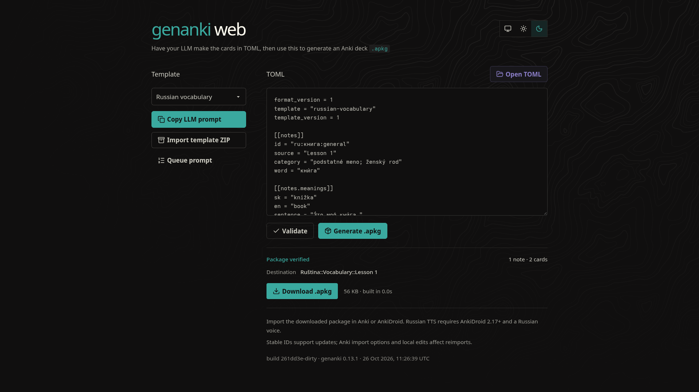

# genanki web

- Turn LLM-generated TOML into downloadable Anki `.apkg` decks entirely in your browser.
- Copy self-contained LLM instructions with shared queue rules and a schema-generated TOML structure.
- View and copy the shared queue prompt in a native dialog, with a link to edit its source on GitHub.
- Use bundled Russian vocabulary and question-and-answer templates, or import a local template ZIP.
- Validate complete batches with errors identifying the affected note and field.
- Preserve explicit note identities across corrections, remove identical duplicates, and reject conflicting IDs.
- Route Russian notes into source decks or a mixed deck automatically.
- Generate two Russian cards per note with paired Slovak/English meanings and native Russian TTS expressions.
- Keep Unicode stress marks and escape content safely without rendering imported card HTML in the app.
- Build packages using pinned, self-hosted Pyodide and genanki in a cancellable worker.
- Verify ZIP integrity, SQLite contents, identities, field order, and card counts before downloading.
- Keep TOML and imported packs in memory, with only your appearance preference saved between visits.
- Follow system appearance or choose light and dark Flexoki themes in a mobile-friendly interface.
- Display the build commit, genanki version, and UTC build time baked into the bundle.
- Deploy as static files on GitHub Pages after automated compiler, runtime, Chromium, and Firefox checks.
