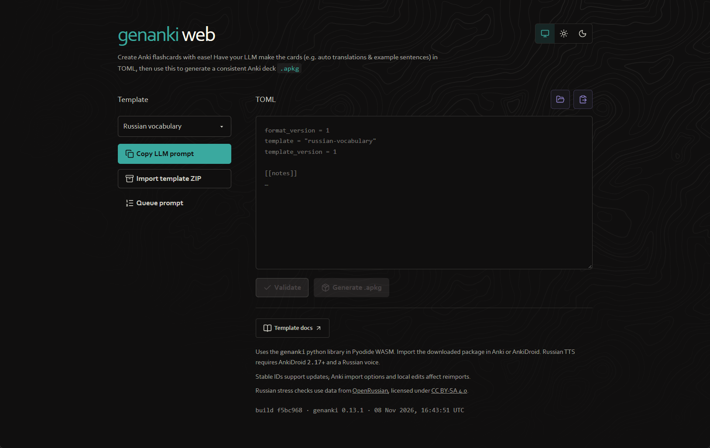
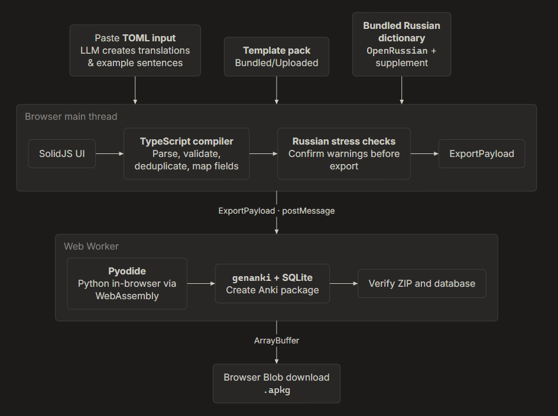

# genanki web

Generate Anki Decks (`.apkg`) fully in your browser (even on your phone!)

## usage
1. Copy the LLM prompt (for your particular template, e.g. Russian vocabulary)
2. Find vocabulary in the wild! YouTube, Netflix, ... just copy / screenshot it
3. Paste it into the LLM 
4. At some point, write `flush`, `export`, etc. and the LLM will create some TOML text which represents the deck
5. Paste that TOML into genanki-web. 
6. Validate it, and generate the Anki deck `.apkg`!

## templates
I made genanki-web to learn Russian, so it bundles an example template and the **Russian Vocabulary** template.  
You can create your own deck templates by following the [docs](https://kraxen72.github.io/genanki-web/docs.html), and either load them from your device, on open a pull request to this repo. 

Templates:  
- validate using JSON schemas, including RegEx, and optionally, correct stress mark placement from an open Russian dictionary.
- preserve explicit note identities across corrections, remove identical duplicates, and reject conflicting IDs.
- will either make a deck at your desired route depending on the source, such as `Russian::Vocabulary::<source>`, or at a fallback, e.g. `Russian::Vocabulary::Mix`

## quality of life
- genanki-web uses a pinned known-good version of the python `genanki` library to generate anki cards deterministically.
- genanki-web will verify ZIP integrity, SQLite contents, identities, field order, and card counts before downloading.

## how it works
  

Shout out to Simon Willison, because of him, I knew that Pyodide exists, has a WASM build, and can be used like this in the browser.
_I'll write a blog post about this later. Stay tuned!_  