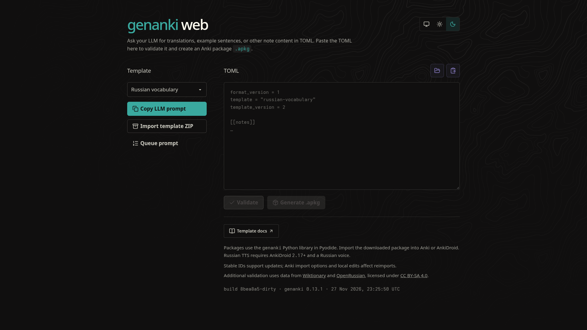
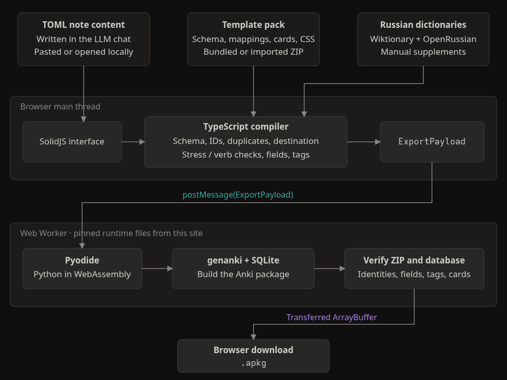

# genanki web

Generate Anki decks (`.apkg`) fully in your browser (even on your phone!). An LLM writes the notes as TOML, and genanki web validates them and builds the deck locally.

## usage
1. Pick a template (e.g. Russian vocabulary) and click **Copy LLM prompt**
2. Paste the prompt into your LLM conversation
3. Find vocabulary in the wild! YouTube, Netflix, ... just copy / screenshot it and send it to the LLM
4. At some point, write `flush`, `export`, etc. and the LLM will give you TOML text which represents the notes
5. Paste that TOML into genanki web (or load a file with **Open TOML**)
6. Click **Validate**, fix any errors and look over the warnings
7. Generate the deck, download the `.apkg` and import it into Anki or AnkiDroid!

If the LLM corrects a note later, keep its ID. That way, re-importing updates the existing note in Anki instead of adding a new one.

## templates
I made genanki web to learn Russian, so it bundles a simple **Question & answer** template and the **Russian vocabulary** template.
You can create your own templates by following the [docs](https://kraxen72.github.io/genanki-web/docs.html) (there's a starter ZIP), and either load them from your device with **Import template ZIP**, or open a pull request to this repo.

Templates:
- validate the TOML using JSON schemas, including RegEx.
- preserve note IDs across corrections, remove identical duplicates, and reject conflicting IDs.
- put notes into a deck based on their source, such as `Ruština::Vocabulary::<source>`, or into a fallback, e.g. `Ruština::Vocabulary::Mix`.

The Russian vocabulary template also checks stress marks, verb aspect, aspect partners and motion verb pairs against open Russian dictionaries (Wiktionary and OpenRussian). Errors block the export; warnings make you click **Export anyway**. See the [pack reference](docs/packs.md) for details and versioning.

## quality of life
- genanki web uses a pinned known-good version of the Python `genanki` library to generate Anki decks deterministically.
- genanki web verifies ZIP integrity, SQLite contents, note IDs, fields, tags and card counts before offering the download.
- everything stays in your browser: your TOML and imported templates are only kept in memory until you reload the tab.

## how it works

The browser validates the TOML and maps it onto Anki fields. Then a Web Worker runs `genanki` through Pyodide and builds the package. More in [Architecture](docs/design.md) and the [third-party notices](docs/third-party-notices.md).

Shout out to Simon Willison, because of him, I knew that Pyodide exists, has a WASM build, and can be used like this in the browser.
_I'll write a blog post about this later. Stay tuned!_

## desktop Anki fixups
There's also a separate [one-time fixup CLI](tools/anki-fixups/README.md) for desktop Anki. It can add aspect badges to Core 5000 verbs and migrate older vocabulary note types to v4. Preview the changes and make a backup before applying them, and install the Anki library version that matches your desktop app.

## development
Use Node 24 and pnpm 10.34.9, and run `pnpm install --frozen-lockfile` first. The VS Code workspace recommends extensions for Python (desktop tools) and MDX (template docs).

| Command | Description |
| --- | --- |
| `pnpm dev` / `pnpm start` | Run the app at `http://localhost:3000` with live reload |
| `pnpm build` | Generate schemas, prepare runtime assets, check types, and build `dist/` |
| `pnpm serve` | Preview the built site |
| `pnpm test` | Run unit and Pyodide runtime tests |
| `pnpm typecheck` | Check UI and worker types |
| `pnpm test:e2e` | Run Chromium and Firefox tests against the running dev server |
| `pnpm format` / `pnpm format:check` | Format or check source, tests, scripts, and template HTML/CSS |
| `pnpm schemas:generate` | Regenerate bundled input schemas and TypeScript contracts |
| `pnpm ru-stress:generate [dump.jsonl.gz]` | Rebuild the Russian stress dictionary |
| `pnpm ru-aspect:generate [dump.jsonl.gz]` | Rebuild the aspect dictionary, TSV, and source metadata |
| `pnpm ru-data:generate [dump.jsonl.gz]` | Rebuild both dictionaries in one Wiktionary pass |
| `python -m pytest tools/anki-fixups/tests` | Test the desktop Anki tools after [Python setup](tools/anki-fixups/README.md#install) |

The dictionary commands download the full 3 GB Wiktionary dump from kaikki.org (plus OpenRussian data). To reuse a copy you already downloaded, pass its path, e.g. `pnpm ru-data:generate path/to/raw-wiktextract-data.jsonl.gz`. The script prints which version of each source it used; put that in the commit message.

More in [Development](docs/development.md) (browser setup, deployment) and [Verification](docs/verification.md) (test coverage, measurements, AnkiDroid checks).
